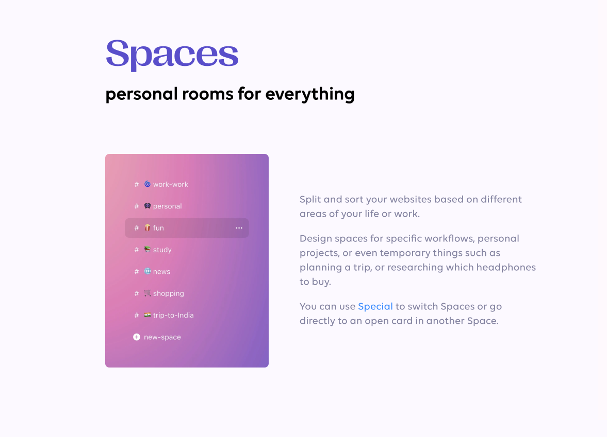
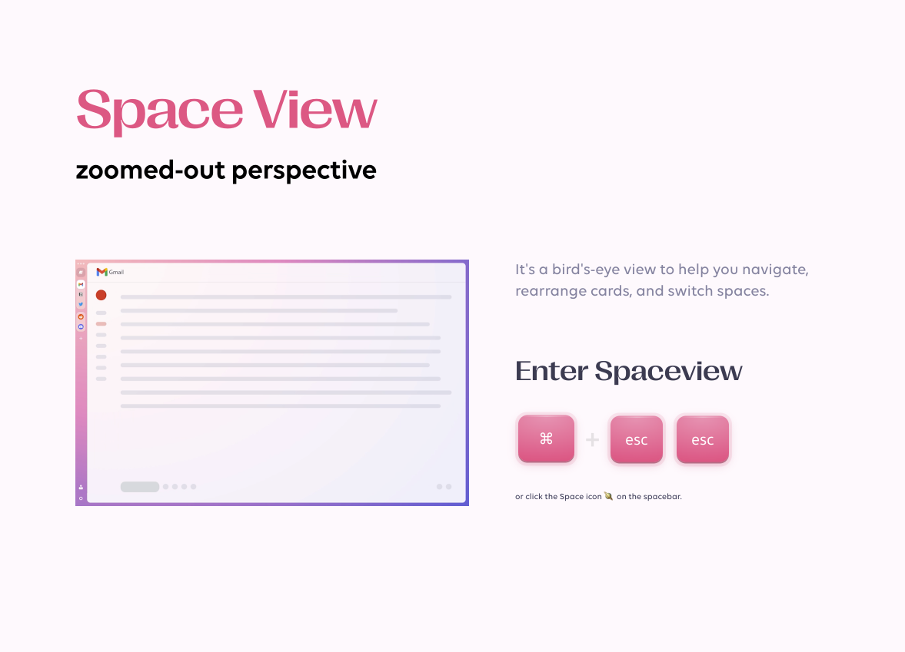

# Stack

A desktop browser that organizes web apps around the way you work.

## Give your work a space

Stack brings websites and web apps into a workspace of cards, spaces and separate browser profiles. The idea is to keep related work together and make moving between contexts feel natural.

- **Cards:** web apps arranged in a visual workspace.
- **Spaces:** separate contexts for different projects and activities.
- **Profiles:** distinct browsing identities within the workspace.

## Current work

Development is focused on a Chromium-based rebuild, carrying Stack's workspace design and interaction model into a new browser foundation. That rebuild remains in development.

**Technology:** Chromium, C++, React and TypeScript.

This repository presents the product and current direction. Application source is maintained privately.

*The illustrations are from the existing Stack product's onboarding. They do not depict the current Chromium rebuild.*
